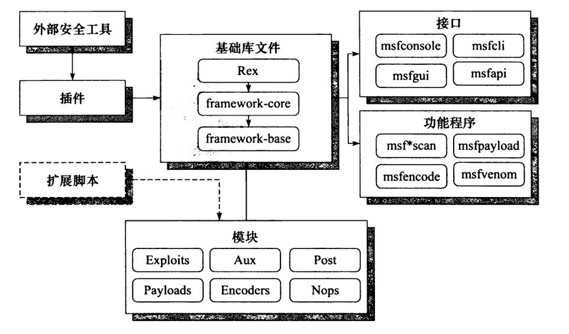
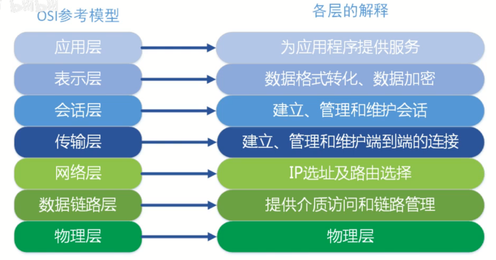

# CS 学习笔记

计算机基础与网络安全方向的自学笔记整理，涵盖编程语言、操作系统、数据库与安全工具，以速查命令和要点记录为主，适合作为日常参考手册。

## 📚 内容分类

笔记按主题分目录。原来的 `.txt` 已改为 Markdown，可在 GitHub 上直接渲染。

| 目录 | 内容 |
| --- | --- |
| [`programming/`](programming) | 编程语言、操作系统与数据库 |
| [`security/`](security) | 渗透测试与安全工具 |
| [`web/`](web) | 网页制作与相关练习 |
| [`images/`](images) | 架构图与模型图 |

**编程与系统基础**

| 文件 | 内容 |
| --- | --- |
| [`programming/C语言笔记.md`](programming/C语言笔记.md) | C 语言基础语法要点 |
| [`programming/python.md`](programming/python.md) | Python 学习笔记 |
| [`programming/linux备忘录.md`](programming/linux备忘录.md) | Linux 常用命令速查 |
| [`programming/基本dos命令.md`](programming/基本dos命令.md) | Windows DOS 基础命令 |
| [`programming/bat.md`](programming/bat.md) | Windows 批处理（batch）脚本示例 |
| [`programming/MySql.md`](programming/MySql.md) | MySQL 数据库常用操作 |
| [`programming/test.py`](programming/test.py) | Python 练习 |

**网络安全方向**

| 文件 | 内容 |
| --- | --- |
| [`security/kali常用工具指令.md`](security/kali常用工具指令.md) | Kali Linux 渗透工具速查 |
| [`security/Metasploit渗透测试魔鬼训练营读书笔记.md`](security/Metasploit渗透测试魔鬼训练营读书笔记.md) | Metasploit 框架学习笔记 |
| [`images/metasploit结构.PNG`](images/metasploit结构.PNG) | Metasploit 架构图 |
| [`images/七层OSI.png`](images/七层OSI.png) | OSI 七层网络模型图 |

**Web**

| 文件 | 内容 |
| --- | --- |
| [`web/HTML.md`](web/HTML.md) | HTML 网页制作笔记 |
| [`web/test.php`](web/test.php) | PHP 基础练习 |

## 🚀 使用方式

笔记为 Markdown（`.md`），在 GitHub 上按标题阅读即可，也可在本地打开后检索命令。练习代码见 `programming/test.py` 与 `web/test.php`。

## ⚠️ 免责声明

安全相关笔记仅用于**合法授权**环境下的学习与研究。请在自己拥有或已获书面授权的系统上进行安全测试，遵守当地法律法规。

## 📄 许可证

[MIT License](LICENSE)
